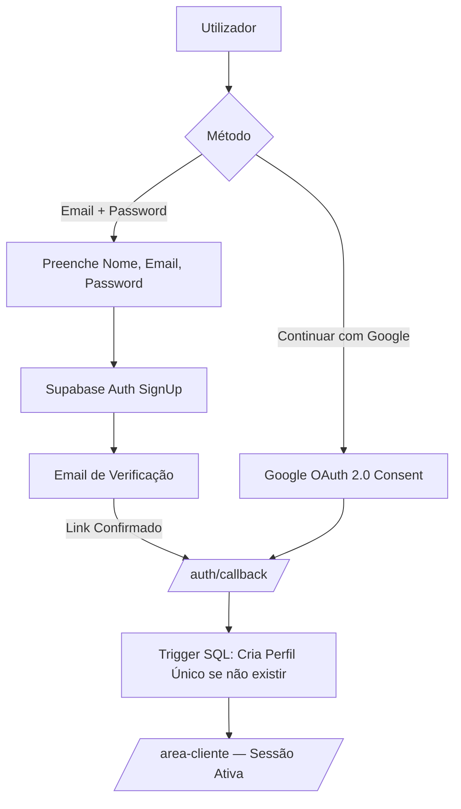

# Arquitetura de Autenticação e Área de Cliente — LeadCapture

## 1. Análise da Stack e Solução Recomendada
- **Stack Atual:** Next.js 15 (App Router, Server Components, Middleware), TypeScript, Tailwind CSS v4.
- **Solução Recomendada:** **Supabase Auth + PostgreSQL + Row Level Security (RLS)** com `@supabase/ssr`.
  - **Porquê Supabase Auth:**
    - Suporta nativamente os 6 métodos exigidos: Registo Email/Password, Login Email/Password, Registo Google OAuth 2.0, Login Google OAuth 2.0, Recuperação de Password e Verificação de Email.
    - Gestão segura de sessões via cookies `HttpOnly` em Next.js App Router (`@supabase/ssr` + `middleware.ts`).
    - Hashing seguro de palavras-passe (nunca em texto simples).
    - Base de dados PostgreSQL integrada com **Row Level Security (RLS)** para isolamento absoluto dos dados de cada cliente e separação de permissões `client` vs `admin`.
    - Trigger automático na criação de utilizador (`auth.users`) para gerar o perfil único na tabela `public.profiles`.

---

## 2. Métodos de Autenticação Suportados
1. **Registo com Email e Palavra-passe** (`/registar`) — recolhe Nome, Email, Palavra-passe e Confirmação de Palavra-passe; envia email de verificação obrigatório antes de ativar sessão completa.
2. **Login com Email e Palavra-passe** (`/login`) — valida credenciais e estabelece sessão segura por cookie.
3. **Registo com Google OAuth 2.0** (`/registar` → botão *Continuar com Google*) — redireciona para Google Consent Screen → `/auth/callback` → cria utilizador e perfil único automaticamente.
4. **Login com Google OAuth 2.0** (`/login` → botão *Continuar com Google*) — autentica via OAuth 2.0 e renova sessão.
5. **Recuperação de Palavra-passe** (`/recuperar-password`) — envia link seguro temporário para redefinição em `/atualizar-password`.
6. **Verificação de Email** — confirmação obrigatória via token assinado enviado por email antes de acesso completo à Área de Cliente.

---

## 3. Fluxos de Registo e Login



### Associação Segura de Contas com o Mesmo Email
- Se um cliente se registar primeiro com Email/Password (com email verificado) e mais tarde clicar em *Continuar com Google* com o mesmo email verificado, o **Supabase Auth (Automatic Identity Linking)** associa ambas as identidades ao mesmo `user_id` **apenas quando ambos os provedores confirmam a titularidade do email**, prevenindo hijacking de conta.

---

## 4. Modelo de Utilizadores e Área de Cliente (`supabase/schema.sql`)
Cada utilizador tem um `id` (`UUID` de `auth.users`) ligado 1:1 a `public.profiles`:
- **Dados pessoais:** `full_name`, `email`, `phone`, `avatar_url`, `role` (`'client' | 'admin'`).
- **Dados da empresa:** `company_name`, `nif`, `sector`, `company_address`.
- **Entidades ligadas por `client_id` (FK → `profiles.id`):**
  - `orders` (Encomendas e estado)
  - `client_services` (Serviços contratados / ativos)
  - `contracts` (Contratos aceites e versão/data)
  - `payments` (Registos de pagamento — fase futura)
  - `materials` (Materiais entregues pelo cliente e entregáveis)
  - `support_tickets` (Pedidos de suporte)

---

## 5. Segurança e Isolamento de Dados
- **OAuth 2.0 + PKCE:** Fluxo PKCE obrigatório no Next.js App Router (`/auth/callback`).
- **Sem palavras-passe em texto simples:** Gerido internamente pelo Supabase GoTrue (bcrypt/scrypt).
- **Proteção de rotas privadas:** `middleware.ts` verifica sessão válida antes de permitir acesso a `/area-cliente/*` e `/admin/*`; utilizadores não autenticados são redirecionados para `/login`.
- **Isolamento por Row Level Security (RLS):**
  - Políticas `SELECT / INSERT / UPDATE` exigem `auth.uid() = client_id` para clientes.
  - Um cliente **nunca** pode consultar ou alterar registos de outro cliente, mesmo via API direta.
  - Administradores (`role = 'admin'`) têm políticas específicas auditáveis para gestão global.
- **Segredos:** `SUPABASE_SERVICE_ROLE_KEY` e `GOOGLE_CLIENT_SECRET` nunca são expostos no cliente (`NEXT_PUBLIC_*` apenas para URL e Anon Key).

---

## 6. Configurações Externas Necessárias

### A. Google Cloud Console
1. Criar/selecionar projeto em *Google Cloud Console → APIs & Services*.
2. Configurar **OAuth Consent Screen** (External, nome da app `LeadCapture`, domínio autorizado `leadcapture.cloud`, email de suporte).
3. Criar credenciais **OAuth 2.0 Client ID (Web application)**:
   - **Authorized JavaScript origins:**
     - `http://localhost:3000` (desenvolvimento)
     - `https://leadcapture.cloud` (produção)
   - **Authorized redirect URIs:**
     - `https://<SEU_PROJETO_SUPABASE>.supabase.co/auth/v1/callback`
4. Guardar `Client ID` e `Client Secret`.

### B. Painel Supabase
1. Ativar **Authentication → Providers → Google** e colar `Client ID` e `Client Secret` do Google.
2. Em **Authentication → URL Configuration**:
   - **Site URL:** `https://leadcapture.cloud` (ou `http://localhost:3000` em dev)
   - **Redirect URLs:**
     - `http://localhost:3000/auth/callback`
     - `https://leadcapture.cloud/auth/callback`
3. Executar `supabase/schema.sql` no SQL Editor para criar tabelas, triggers e políticas RLS.

### C. Variáveis de Ambiente (`.env.example`)
```env
NEXT_PUBLIC_SITE_URL=http://localhost:3000
NEXT_PUBLIC_SUPABASE_URL=https://your-project-id.supabase.co
NEXT_PUBLIC_SUPABASE_ANON_KEY=your-supabase-anon-key
```

---

## 7. Plano de Testes
1. **Registo Email/Password:** Validar confirmação de password, criação de utilizador, envio de email de verificação e criação automática de registo em `public.profiles`.
2. **Verificação de Email:** Confirmar que acesso a `/area-cliente` permanece bloqueado até clicar no link de verificação.
3. **Registo e Login Google OAuth:** Testar fluxo completo em `/registar` e `/login` via Google, validando criação automática de perfil na primeira entrada e reutilização do mesmo `user_id` nas entradas seguintes.
4. **Associação de Contas:** Registar conta por email, verificar email, depois entrar com Google usando o mesmo email e confirmar que mantém o mesmo `profile_id` e histórico.
5. **Recuperação de Password:** Solicitar recuperação em `/recuperar-password`, abrir link recebido e definir nova palavra-passe.
6. **Isolamento RLS (Segurança):** Criar Cliente A e Cliente B; tentar consultar encomendas/materiais de Cliente B autenticado como Cliente A e confirmar retorno vazio / erro de permissão (`403`/`0 rows`).
7. **Controlo de Sessão e Rotas Privadas:** Aceder a `/area-cliente` sem sessão → redirecionamento imediato para `/login`.
